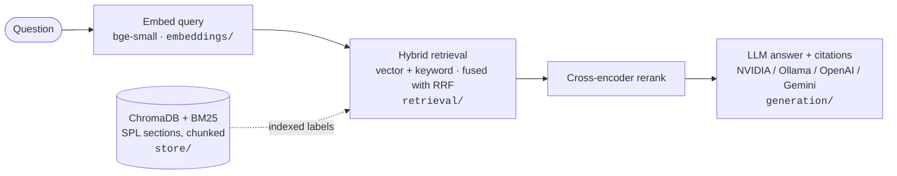

# 💊 Pharma RAG — Grounded Q&A over FDA Drug Labels

Ask questions about prescription drugs and get answers grounded in official FDA
labels (DailyMed SPL documents), with citations to the exact label sections.
Built as a portfolio project for AI/LLM engineer roles.

Live demo: https://pharma-rag.129-80-41-146.nip.io/



## Why this design

| Decision | Reason |
|---|---|
| DailyMed SPL XML, not web scraping | Official FDA labels, structured sections, stable API, no auth |
| Chunk by label section | Keeps contraindications/dosage/warnings topically pure; better than fixed windows |
| Hybrid search (ChromaDB cosine + BM25 keyword, RRF fusion) | Drug names are exact-match heavy ("atorvastatin" vs "a statin") — keyword search catches what vectors miss *(Tradeoff: BM25 runs over the full corpus in Python, fine at this scale)* |
| Cross-encoder rerank | Cheap precision boost on the top-20 before generation |
| Local embeddings (bge-small) + extractive fallback | Whole pipeline answers at **₹0** with no LLM key |
| Strict grounded prompting | Every claim cited `[1]`; "not in the labels" instead of hallucinating; medical disclaimer appended |
| Hand-rolled evals (hit@k, MRR) | Retrieval quality measured against a golden set, not vibes |

## Quickstart

**1. Install & configure**
```bash
python -m venv .venv && source .venv/bin/activate
pip install -r requirements.txt
cp .env.example .env
```

**2. Download labels**
```bash
python scripts/download_labels.py --drugs atorvastatin metformin lisinopril
```

**3. Build the index** (downloads bge-small ~130MB once, CPU fine)
```bash
python scripts/build_index.py
# ...or pre-index in one step (download + index, no intermediate files):
python scripts/preindex.py --drugs atorvastatin metformin lisinopril
```

**4. Set the LLM key** (NVIDIA API, the hosted default)
```bash
# in .env: LLM_PROVIDER=nvidia (default) + NVIDIA_API_KEY=<your key>
# Base URL and model are env-overridable: NVIDIA_BASE_URL, NVIDIA_MODEL.
# With no key set, /ask answers with the built-in extractive fallback
# (still cited, ₹0); only Agent mode needs a working LLM.
# Local alternatives: LLM_PROVIDER=ollama (ollama pull llama3.1 && ollama
# serve), =gemini + GEMINI_API_KEY, or =openai + OPENAI_API_KEY.
```

**5. Ask questions**
```bash
cd frontend && npm install && npm run build && cd ..   # build the React UI once
uvicorn src.api.main:app --reload                       # API + UI on :8000
# Frontend dev server instead: cd frontend && npm run dev  (proxies to :8000)
# Streamlit (local-only option): streamlit run src/ui/app.py
#   (standalone; set API_URL=http://localhost:8000 to use the API instead)
```
Try: *"What are the contraindications of atorvastatin?"*

The UI has two modes (top bar): **Chat** (remembers the conversation — try a
follow-up like *"what about its dosage?"*), and **Agent** (ReAct: the model
plans its own tool calls, with a visible trace).

## Deploying the demo (Docker)

One container serves the FastAPI backend and the built React frontend:

```bash
docker build -t pharma-rag .
docker run -p 8000:8000 -v pharma-data:/app/data --env-file .env pharma-rag
```

- The container listens on `$PORT` (default 8000). The only secret it needs
  is `NVIDIA_API_KEY` in the env file; the model and base URL default to
  `nvidia/nemotron-3-ultra-550b-a55b` and `https://integrate.api.nvidia.com/v1`
  and are overridable via `NVIDIA_MODEL` / `NVIDIA_BASE_URL`.
- The `/app/data` volume holds the ChromaDB index (`data/chroma`), the
  DailyMed SPL cache (`data/spl_cache`) and the downloaded embedding/reranker
  models (`data/hf`) — persist it or the first question re-downloads everything.
- The index starts empty. Pre-index the demo drugs once the container is up
  (each takes ~30–60s on first index; already-indexed drugs are skipped):
  ```bash
  curl -X POST localhost:8000/index -H 'Content-Type: application/json' \
    -d '{"drugs": ["atorvastatin", "metformin", "lisinopril"]}'
  ```
  Without pre-indexing, the first question about any drug triggers the same
  on-demand indexing from DailyMed (~30–60s), then it's instant.
- First load takes a few minutes (embedding + reranker models download once).

Notes:
- Without an LLM, answers use the built-in extractive fallback (still cited).
  For full LLM answers, set `NVIDIA_API_KEY` (hosted default). Local
  alternatives:
  - Gemini (free tier): `LLM_PROVIDER=gemini` + `GEMINI_API_KEY` (get one at
    [Google AI Studio](https://aistudio.google.com/apikey)). Default model:
    `gemini-3.6-flash` (pinned in `src/config.py`; 2.5-flash is retired for new API keys), or
  - OpenAI: `LLM_PROVIDER=openai` + `OPENAI_API_KEY`, or
  - Ollama (local, free): `LLM_PROVIDER=ollama` + a running Ollama server.
- Agent mode needs a chat LLM, so it requires one of the keys above.
- The UI shows honestly which mode an answer came from: LLM answers name the
  model; fallback answers say so ("Answered from label excerpts").

**6. Run evals**
```bash
pytest tests/                             # unit tests
python -m src.evals.run_evals             # retrieval hit@k / MRR on golden set
python -m src.evals.run_evals --no-rerank # ablation: reranker off
```

## API

| Method | Path | Description |
|---|---|---|
| `GET` | `/health` | Service status, indexed chunk count, and LLM provider status (`llm.provider`/`llm.model`/`llm.configured`; no secrets) |
| `GET` | `/drugs` | Drugs currently indexed |
| `POST` | `/ask` | Grounded answer with citations; supports chat history and follow-ups |
| `POST` | `/ask-agent` | ReAct agent: plans its own tool calls, returns answer + full trace |
| `POST` | `/index` | Pre-index drugs from DailyMed; returns indexed / already_indexed / failed + total chunk count |

- `POST /ask` → `{answer, sources[{ref, drug_name, section_title, score, preview}], model}`
  - accepts optional `history: [{role: "user"|"assistant", content}]` for chat mode;
    follow-ups are rewritten into standalone questions before retrieval, and the
    response includes `rewritten_question` when a rewrite happened.
- `POST /ask-agent` → `{answer, sources, model, trace[{iteration, thought, action, args, observation}], iterations, indexed_drugs}`
  - ReAct agent: the model plans its own tool calls (`search_labels`,
    `fetch_drug_label`, `list_indexed_drugs`) instead of following the fixed
    pipeline. The trace shows every step — great for demos and debugging.
- `POST /index` → `{indexed, already_indexed, failed, total_chunks}`
  - same on-demand path a first question triggers, callable up front so the
    first question is instant. Each new drug takes ~30–60s.

```bash
curl -X POST localhost:8000/ask -H 'Content-Type: application/json' \
  -d '{"question": "Which drugs interact with atorvastatin?"}'

# Chat mode: follow-up resolved against history
curl -X POST localhost:8000/ask -H 'Content-Type: application/json' -d '{
  "question": "what about its dosage?",
  "history": [{"role": "user", "content": "What are the contraindications of atorvastatin?"},
              {"role": "assistant", "content": "Atorvastatin is contraindicated in ..."}]
}'

# Agent mode: compare two drugs (the agent fetches + searches on its own)
curl -X POST localhost:8000/ask-agent -H 'Content-Type: application/json' \
  -d '{"question": "Compare the side effects of atorvastatin and rosuvastatin."}'

# Pre-index drugs so the first question about them is instant
curl -X POST localhost:8000/index -H 'Content-Type: application/json' \
  -d '{"drugs": ["atorvastatin", "metformin", "lisinopril"]}'

# Terminal demo of the agent loop
python scripts/agent_chat.py "Compare the side effects of atorvastatin and rosuvastatin"
```

Example responses (trimmed for brevity):

```bash
curl localhost:8000/health
# → {"status": "ok", "indexed_chunks": 346,
#     "llm": {"provider": "gemini", "model": "gemini-3.6-flash", "configured": true}}

curl localhost:8000/drugs
# → {"drugs": ["atorvastatin", "rosuvastatin", "metformin"]}
```

`POST /ask` — grounded answer with per-source citations:

```json
{
  "answer": "Atorvastatin interacts with strong CYP3A4 inhibitors ...",
  "sources": [
    {"ref": 1, "drug_name": "atorvastatin", "section_title": "Drug Interactions",
     "score": 0.87, "preview": "Avoid concomitant use with strong CYP3A4 ..."}
  ],
  "model": "gemini-3.6-flash",
  "indexed_drug": "atorvastatin",
  "rewritten_question": null
}
```

`POST /ask-agent` — answer plus the full ReAct trace:

```json
{
  "answer": "Rosuvastatin's most common side effects are ...",
  "sources": [
    {"ref": 1, "drug_name": "rosuvastatin", "section_title": "Adverse Reactions",
     "score": 0.81, "preview": "..."}
  ],
  "model": "gemini-3.6-flash",
  "trace": [
    {"iteration": 1, "thought": "I need the side effects of both drugs.",
     "action": "fetch_drug_label", "args": {"drug": "rosuvastatin"},
     "observation": "indexed 114 chunks"}
  ],
  "iterations": 3,
  "indexed_drugs": ["rosuvastatin", "atorvastatin"]
}
```

## Modes: Ask, Chat, Agent

The project now demonstrates all three patterns from the chatbot → agent ladder:

| | Ask (RAG pipeline) | Chat (chatbot) | Agent (ReAct) |
|---|---|---|---|
| Control flow | Fixed: retrieve → rerank → generate | Fixed pipeline + memory | Model decides: think → act → observe → … |
| Memory | None | Conversation history (sent as `history`); follow-ups rewritten via `generation/rewrite.py` | Tool-call trace; gathers its own evidence |
| New code | — | `src/generation/rewrite.py`, `history` in `/ask` + UI chat mode | `src/agent/` (`tools.py` registry + `react.py` loop), `/ask-agent` |
| Good for | One-shot questions | Follow-ups: "what about its dosage?" | Multi-step: "compare X and Y", unindexed drugs |

Grounding is identical in all three: the agent's gathered chunks go through the same
`generate_answer` pipeline, so citations and the medical disclaimer never change.

## Project layout

```
src/
  ingest/      dailymed.py (API client) · spl_parser.py (SPL XML → sections) · chunk.py
  embeddings/  embedder.py (sentence-transformers, lazy-loaded)
  store/       vectorstore.py (ChromaDB + BM25 keyword search, RRF hybrid search)
  retrieval/   retriever.py (hybrid → cross-encoder rerank)
  generation/  answer.py (grounded prompting, NVIDIA/Ollama/OpenAI/Gemini) · rewrite.py (follow-up → standalone question)
  agent/       tools.py (tool registry: search/fetch/list) · react.py (ReAct think→act→observe loop)
  api/         main.py (FastAPI: /health, /drugs, /ask, /ask-agent, /index; serves frontend/dist)
  ui/          app.py (Streamlit, local-only: Ask / Chat / Agent modes)
  evals/       golden.json · run_evals.py
frontend/      React + Vite + TypeScript UI (Chat / Agent, cited answers, index status)
scripts/       download_labels.py · build_index.py · preindex.py (one-step pre-index) · agent_chat.py (terminal agent demo)
tests/         unit tests (parser, chunker, RRF, API, generation, ReAct parser)
Dockerfile     one container: FastAPI + built React frontend (see Deploying the demo)
```

## Known limitations (honest)

- Answers only cover indexed labels; add more drugs via `preindex.py` (or `download_labels.py` + `build_index.py`).
- Brand ↔ generic name resolution is naive (DailyMed search handles most cases).
- No dosage *calculations* — the model quotes label text; it must never compute a dose.
- Eval set is small (12 questions); grow it as you index more drugs.
- This is a demo, not a medical device. The disclaimer is load-bearing.

## Cost

With no LLM key, the extractive fallback answers at ₹0 (local embeddings
only). With `NVIDIA_API_KEY` set, answers use NVIDIA's API (see your NVIDIA
plan for pricing). With OpenAI (`gpt-4o-mini`), roughly ₹2–5 per 100 questions.
